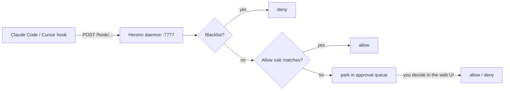

# Heronn

A local policy daemon for AI coding agents. Heronn sits between an agent (Claude Code, Cursor) and your machine: dangerous shell commands are blocked, known-safe command classes are allowed automatically, and everything else waits in a queue for you to approve or deny from a small web UI.

AI coding agents run shell commands and edit files on your behalf, and per-tool permission prompts are easy to click through or are all-or-nothing. Heronn gives you one place to set the rules once (blacklist, allow rules per command class, per project or per machine) and review only the commands that no rule covers.

## How it works

Agent hooks send each intended tool call to the daemon before it runs. The daemon decides, and the hook relays the answer back to the agent.



Policy order: global blacklist, then the machine-wide allowlist, then the project allowlist, then park for a human. Approving a command with "this project" or "this PC" stores its command class and prefix in `server/policy/policies.json`. The blacklist is always machine-wide and cannot be weakened by a project allow. A parked request that is not answered within 9 minutes falls back to the agent's own permission prompt. Decisions and logs are kept in a local SQLite database (`app.db`, created in the repo root).

## Requirements

- Node.js 22 (the repo is developed on Node 22).
- `better-sqlite3` is a native module. It normally installs a prebuilt binary; otherwise `npm install` compiles it and needs a C/C++ toolchain and Python (Windows: Visual Studio Build Tools; macOS: Xcode command line tools; Linux: `build-essential`).
- Developed on Windows; the hooks and relays are plain Node scripts intended to work on Linux and macOS as well (not tested on every OS).

## Install and run

```bash
npm install
npm run dev
```

- Daemon: http://localhost:7777 (`GET /api/health` returns `{ "ok": true }`)
- Web UI: http://localhost:5173 (proxies `/api` to the daemon)

`npm run dev` starts both; `npm run dev:server` and `npm run dev:web` start them separately.

## Connect your agent

Heronn ships ready-made hook configs for this repository. Open **this folder** as the project in the agent, and keep the daemon running.

### Claude Code

[`.claude/settings.json`](.claude/settings.json) registers a `PreToolUse` hook (matcher `Bash|Write|Edit|NotebookEdit`) that runs `node .claude/hooks/relay.mjs`. The relay POSTs the hook payload to `http://127.0.0.1:7777/hook/claude-code` with a 540 s timeout. If the daemon is down, the relay answers `ask`, so Claude Code shows its normal permission prompt.

To use Heronn in another project, copy `.claude/hooks/relay.mjs` and the `hooks` block of `.claude/settings.json` into that project.

### Cursor

[`.cursor/hooks.json`](.cursor/hooks.json) registers `beforeShellExecution`, `afterShellExecution`, `preToolUse`, `beforeMCPExecution` and `postToolUse` hooks that run `node .cursor/hooks/relay.mjs`, which POSTs to `http://127.0.0.1:7777/hook/cursor`. The blocking hooks are `failClosed`: if the daemon is down or times out, the action is blocked.

Troubleshooting:

- Open the repo root in Cursor itself (not only in another editor) and use the Agent in that window; reload the window after changing hooks.
- The UI footer should read LIVE, and `GET http://127.0.0.1:7777/api/diag` shows hook hit counters.
- Ask the agent to run an unknown command (for example `python evil.py`); common classes such as `npm install` may already be auto-allowed.

### Try it without an agent

With the daemon running, `node test.js` and `node test2.js` post simulated Claude Code / Cursor / MCP traffic so cards appear in the queue, and `node hook-ping/ping.js` pings the Claude Code hook.

## Configuration

- Rules live in [`server/policy/policies.json`](server/policy/policies.json) (the `my-repo` entry is a placeholder example; the file is rewritten as you approve commands): `blacklist` (prefixes, binaries), `classMap` (package manager to command class), `machine` and per-repo `projects` allow lists.
- Ports (7777 for the daemon, 5173 for Vite) are currently hard-coded in `server/index.ts`, the relays and `web/vite.config.ts`.
- Runtime state is `app.db` in the repo root (git-ignored).

## Tests

```bash
npm run test:policy
```

Also available: `test:blacklist`, `test:evaluate`, `test:issues`, `test:reset`. Load generation against a throwaway repo is described in [loadgen/README.md](loadgen/README.md).

## Project layout

```
server/      Express daemon: hook handlers, policy engine, SQLite, SSE
web/         React 19 + Vite approval UI
shared/      Shared TypeScript types
loadgen/     Multi-agent traffic generator
hook-ping/   Small scripts to ping the hooks
scripts/     Dev utilities
docs/        Codebase notes, roadmap, on-prem and AI-stack plans
.claude/     Claude Code hook config and relay
.cursor/     Cursor hook config and relay
```

More detail in [docs/codebase.md](docs/codebase.md) and [docs/roadmap.md](docs/roadmap.md).

## Status

Hackathon prototype, built at Adria Hack (September 2026). It works end to end on a developer machine but is not hardened, and it is not a security boundary against a hostile agent. Planned work (policy packs, role-based rules, on-prem packaging) is in the roadmap.

## Authors

- Emir Genjac
- Faris Srnja
- Harun Hasagic
- Ena Mehmedagic

## License

MIT. See [LICENSE](LICENSE).
